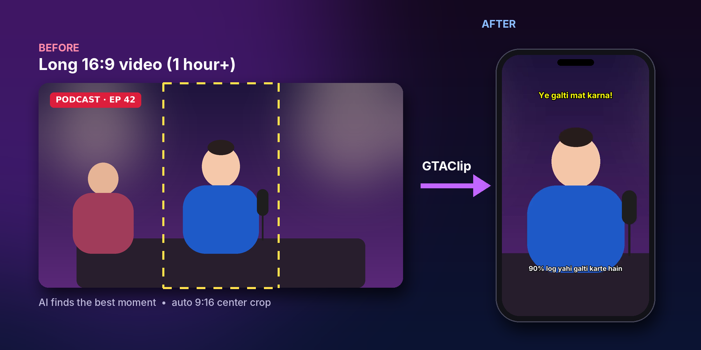

<p align="center">
  
</p>

<p align="center">
  <a href="LICENSE"></a>
  
  
  
</p>

<p align="center">
  <b>GTA = Get The Attention.</b><br>
  Paste a long YouTube video → AI picks the viral moments → get ready-to-post 9:16 clips<br>
  for <b>YouTube Shorts</b>, <b>Instagram Reels</b> and <b>TikTok</b>.
</p>

<p align="center">
  <a href="#-quick-start">Quick start</a> ·
  <a href="#-features">Features</a> ·
  <a href="#-use-it-from-any-ai-coding-tool">AI tools</a> ·
  <a href="#-license">License</a>
</p>

---

## 🎬 Demo

<p align="center">
  
</p>

<p align="center">
  
</p>

<sub>The clip frames above were rendered by GTAClip itself from sample videos.</sub>

---

## ✨ Features

| | Feature | What it does |
|---|---|---|
| 🤖 | **AI clip picking** | An LLM reads the timestamped transcript and scores the most engaging self-contained moments |
| 🧠 | **Any AI model** | Gemini, OpenAI, Claude, or a **free local model** with Ollama |
| 📱 | **Auto 9:16 crop** | Converts landscape video to 1080×1920 vertical |
| 💬 | **Captions + hook** | Burns in captions at the bottom and a bold hook title at the top |
| 🇮🇳 | **Hindi & Hinglish** | Works with Hindi/Hinglish transcripts (use a Devanagari font for Hindi script) |
| 🛡️ | **Safe output handling** | AI timestamps are validated: clamped, length-checked, overlaps removed |
| 📄 | **Manifest** | `manifest.json` with title, hook, score and reason for every clip |
| 💸 | **No limits, no watermark** | Runs on your own computer. Your videos stay with you |

---

## ⚙️ How it works

```
YouTube URL ──► yt-dlp ──► transcript ──► AI picks best moments ──► ffmpeg ──► clip_01.mp4, clip_02.mp4 …
                 (video + subtitles)        (title · hook · score)     (cut · 9:16 · captions)
```

---

## 🚀 Quick start

**1. Install the requirements**

- Python 3.10+
- [ffmpeg](https://ffmpeg.org/download.html) and [yt-dlp](https://github.com/yt-dlp/yt-dlp) on your PATH
- An API key for one AI provider, or [Ollama](https://ollama.com) for free local AI

**2. Install GTAClip**

```bash
git clone https://github.com/kavitarak/GTA-clip.kavi.git
cd GTA-clip.kavi
python -m venv .venv
source .venv/bin/activate        # Windows: .venv\Scripts\activate
pip install -e ".[dev]"
```

**3. Add your API key** (only the one you use)

```bash
export GEMINI_API_KEY=your_key_here        # Windows: set GEMINI_API_KEY=your_key_here
```

**4. Make clips** 🎉

```bash
gtaclip "https://www.youtube.com/watch?v=VIDEO_ID"
```

---

## 🧰 Examples

```bash
# Preview the AI's picks first, without rendering
gtaclip "https://youtu.be/VIDEO_ID" --plan-only

# Use Claude, 8 clips of 15–45 seconds
gtaclip "https://youtu.be/VIDEO_ID" --provider anthropic --clips 8 --min-len 15 --max-len 45

# 100% free and local with Ollama
gtaclip "https://youtu.be/VIDEO_ID" --provider ollama --model llama3.1

# Your own video + your own subtitles
gtaclip my_video.mp4 --transcript my_video.srt --provider openai

# Hindi captions in Devanagari
gtaclip "https://youtu.be/VIDEO_ID" --font "Noto Sans Devanagari" --langs "hi.*,en.*"
```

<details>
<summary><b>All options</b></summary>

| Option | Default | Description |
|---|---|---|
| `--clips` | `5` | How many clips to make |
| `--min-len` / `--max-len` | `20` / `60` | Clip length in seconds |
| `--provider` | `gemini` | `gemini`, `openai`, `anthropic`, `ollama` |
| `--model` | per provider | Model name |
| `--transcript` | – | Use your own `.vtt` or `.srt` |
| `--langs` | `en.*,hi.*` | Subtitle languages to download |
| `--font` | `Arial` | Caption font |
| `--out` | `output` | Output folder |
| `--plan-only` | off | Only show the AI's picks |
| `--keep-source` | off | Keep the downloaded video |

</details>

---

## 🤖 Use it from any AI coding tool

Works with **Claude Code**, **OpenAI Codex**, **Gemini CLI**, **Google Antigravity** and **Cursor**. Open the folder and say:

> Read AGENTS.md, install the project, and make 5 clips from this video: `<URL>`

[`AGENTS.md`](AGENTS.md) tells the agent the layout, the commands and the rules.

---

## 📦 Output

```
output/
├── clip_01.mp4      # 1080×1920, H.264 + AAC, ready to upload
├── clip_01.ass      # captions + hook (editable)
├── clip_02.mp4
└── manifest.json    # title, hook, score, reason, start/end
```

---

## 🗺️ Roadmap

- [ ] Face tracking, so the speaker stays in frame
- [ ] Whisper transcription for videos without subtitles
- [ ] Word-by-word animated captions
- [ ] Simple web UI

Want to help? Pull requests are welcome.

---

## ⚖️ Legal note

Only download and clip videos you own or have permission to use. YouTube's Terms of Service restrict downloading, and copyright applies to the clips you publish.

---

## 📜 License

<table>
<tr>
<td width="90" align="center"></td>
<td>

**GTAClip is free and open source under the [MIT License](LICENSE).**

✅ Use it for personal or commercial work&nbsp;&nbsp; ✅ Copy, modify and share it&nbsp;&nbsp; ✅ Build your own tools on it

The only condition: keep the copyright notice and license text in copies of the code.

<sub>Copyright © 2026 Hemant Tarak (kavi.onlines)</sub>

</td>
</tr>
</table>

---

<p align="center">
  <br>
  Made with ❤️ by <b>kavi.onlines</b> (Kavi Tarak)<br>
  <a href="https://www.youtube.com/@kavi.online">YouTube</a> ·
  <a href="https://t.me/kavitarak">Telegram</a> ·
  <a href="https://linkedin.com/in/hemanttarak">LinkedIn</a><br>
  <sub>⭐ Star this repo if it helped you!</sub>
</p>
