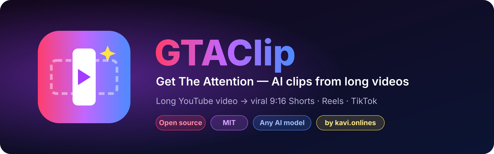
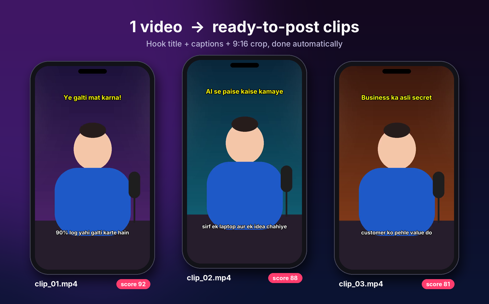
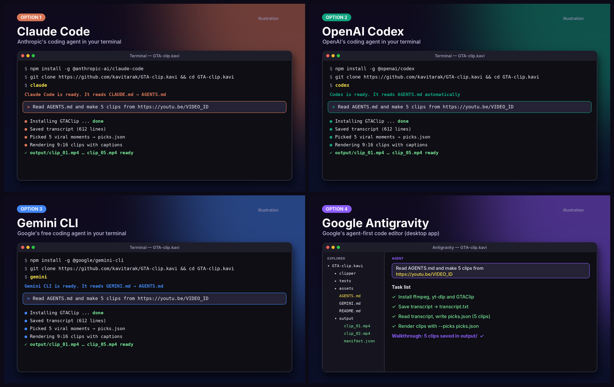
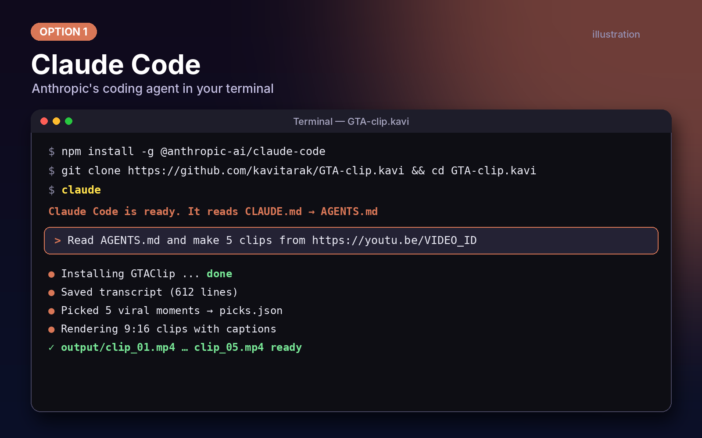
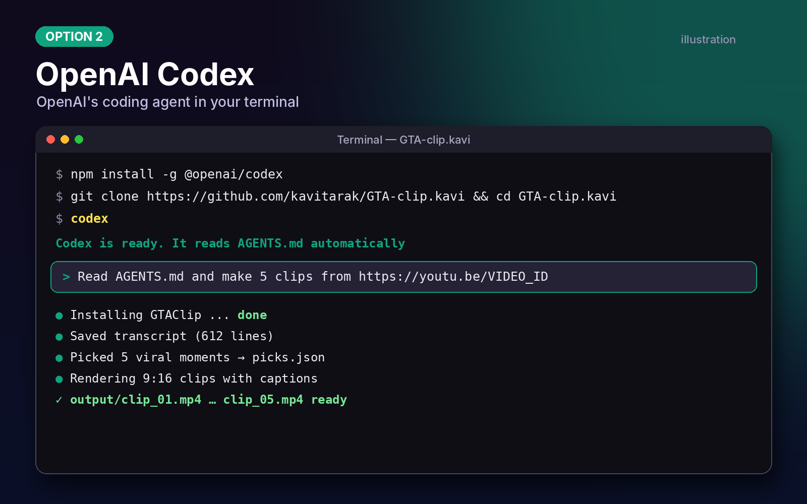
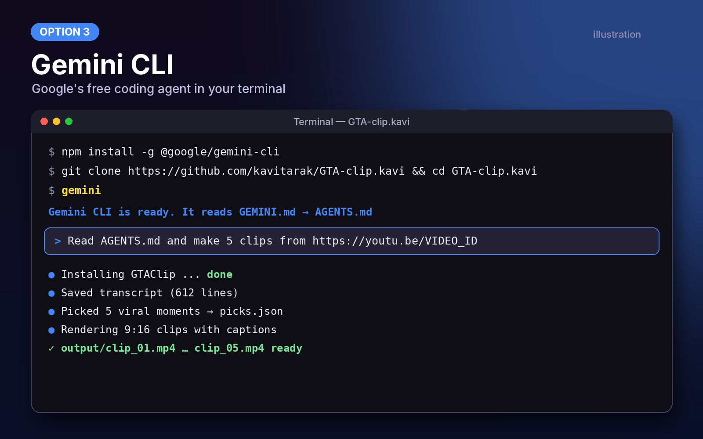
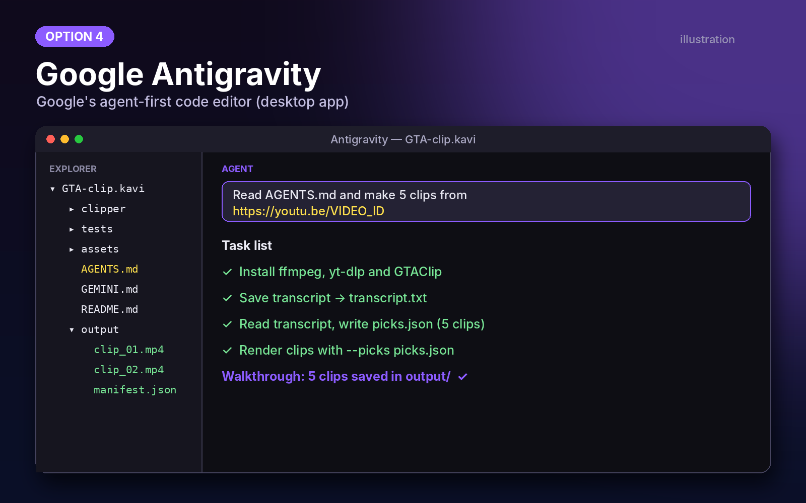

<p align="center">
  
</p>

<p align="center">
  <a href="LICENSE"></a>
  
  
  
</p>

<p align="center">
  <b>GTA = Get The Attention.</b><br>
  Paste a long YouTube video → AI picks the viral moments → get ready-to-post 9:16 clips<br>
  for <b>YouTube Shorts</b>, <b>Instagram Reels</b> and <b>TikTok</b>.
</p>

<p align="center">
  <a href="#-quick-start">Quick start</a> ·
  <a href="#-features">Features</a> ·
  <a href="#-use-it-with-claude-code-codex-gemini-cli-or-antigravity">AI tools</a> ·
  <a href="#-license">License</a>
</p>

---

## 🎬 Demo

<p align="center">
  
</p>

<p align="center">
  
</p>

<sub>The clip frames above were rendered by GTAClip itself from sample videos.</sub>

---

## ✨ Features

| | Feature | What it does |
|---|---|---|
| 🤖 | **AI clip picking** | An LLM reads the timestamped transcript and scores the most engaging self-contained moments |
| 🧠 | **Any AI model** | Gemini, OpenAI, Claude, or a **free local model** with Ollama |
| 🧑‍💻 | **Works inside AI coding tools** | Claude Code, Codex, Gemini CLI and Antigravity pick the clips themselves, **no API key** |
| 📱 | **Auto 9:16 crop** | Converts landscape video to 1080×1920 vertical |
| 💬 | **Captions + hook** | Burns in captions at the bottom and a bold hook title at the top |
| 🇮🇳 | **Hindi & Hinglish** | Works with Hindi/Hinglish transcripts (use a Devanagari font for Hindi script) |
| 🛡️ | **Safe output handling** | AI timestamps are validated: clamped, length-checked, overlaps removed |
| 📄 | **Manifest** | `manifest.json` with title, hook, score and reason for every clip |
| 💸 | **No limits, no watermark** | Runs on your own computer. Your videos stay with you |

---

## ⚙️ How it works

```
YouTube URL ──► yt-dlp ──► transcript ──► AI picks best moments ──► ffmpeg ──► clip_01.mp4, clip_02.mp4 …
                 (video + subtitles)        (title · hook · score)     (cut · 9:16 · captions)
```

---

## 🚀 Quick start

**1. Install the requirements**

- Python 3.10+
- [ffmpeg](https://ffmpeg.org/download.html) and [yt-dlp](https://github.com/yt-dlp/yt-dlp) on your PATH
- An API key for one AI provider, or [Ollama](https://ollama.com) for free local AI

**2. Install GTAClip**

```bash
git clone https://github.com/kavitarak/GTA-clip.kavi.git
cd GTA-clip.kavi
python -m venv .venv
source .venv/bin/activate        # Windows: .venv\Scripts\activate
pip install -e ".[dev]"
```

**3. Add your API key** (only the one you use)

```bash
export GEMINI_API_KEY=your_key_here        # Windows: set GEMINI_API_KEY=your_key_here
```

**4. Make clips** 🎉

```bash
gtaclip "https://www.youtube.com/watch?v=VIDEO_ID"
```

---

## 🧰 Examples

```bash
# Preview the AI's picks first, without rendering
gtaclip "https://youtu.be/VIDEO_ID" --plan-only

# Use Claude, 8 clips of 15–45 seconds
gtaclip "https://youtu.be/VIDEO_ID" --provider anthropic --clips 8 --min-len 15 --max-len 45

# 100% free and local with Ollama
gtaclip "https://youtu.be/VIDEO_ID" --provider ollama --model llama3.1

# Your own video + your own subtitles
gtaclip my_video.mp4 --transcript my_video.srt --provider openai

# Hindi captions in Devanagari
gtaclip "https://youtu.be/VIDEO_ID" --font "Noto Sans Devanagari" --langs "hi.*,en.*"
```

<details>
<summary><b>All options</b></summary>

| Option | Default | Description |
|---|---|---|
| `--clips` | `5` | How many clips to make |
| `--min-len` / `--max-len` | `20` / `60` | Clip length in seconds |
| `--provider` | `gemini` | `gemini`, `openai`, `anthropic`, `ollama` |
| `--model` | per provider | Model name |
| `--transcript` | – | Use your own `.vtt` or `.srt` |
| `--langs` | `en.*,hi.*` | Subtitle languages to download |
| `--font` | `Arial` | Caption font |
| `--out` | `output` | Output folder |
| `--plan-only` | off | Only show the AI's picks |
| `--keep-source` | off | Keep the downloaded video |
| `--dump-transcript FILE` | – | Agent mode step 1: save transcript + instructions and stop |
| `--picks FILE` | – | Agent mode step 2: render from your own picks JSON (no API key) |

</details>

---

## 🤖 Use it with Claude Code, Codex, Gemini CLI or Antigravity

<p align="center">
  
</p>

**No API key needed in these tools.** The AI agent reads the transcript itself, picks the best moments, and runs GTAClip to render them. The project ships `AGENTS.md` (read by Codex and Antigravity), `CLAUDE.md` (Claude Code) and `GEMINI.md` (Gemini CLI and Antigravity), so every tool already knows the steps.

### The one prompt that works everywhere

Copy this into any of the tools below:

```text
Read AGENTS.md and make 5 clips from https://youtu.be/VIDEO_ID
```

> 🇮🇳 **Hinglish mein bhi chalega:** `AGENTS.md padho aur is video se 5 clips banao: https://youtu.be/VIDEO_ID`

**What the agent does for you:**
1. Installs ffmpeg, yt-dlp and GTAClip if they are missing
2. Downloads the video and saves the transcript (`--dump-transcript`)
3. Reads the transcript and writes `picks.json` with the best moments
4. Renders the clips (`--picks picks.json`) into the `output/` folder

You need [Node.js](https://nodejs.org) (for the three terminal tools), [Python 3.10+](https://www.python.org/downloads/) and [Git](https://git-scm.com/downloads).

---

### 1️⃣ Claude Code

<p align="center"></p>

```bash
npm install -g @anthropic-ai/claude-code
git clone https://github.com/kavitarak/GTA-clip.kavi.git
cd GTA-clip.kavi
claude
```

Then type the prompt: `Read AGENTS.md and make 5 clips from https://youtu.be/VIDEO_ID`
Claude Code loads `CLAUDE.md`, which points to `AGENTS.md`. Approve the commands it asks to run.

---

### 2️⃣ OpenAI Codex

<p align="center"></p>

```bash
npm install -g @openai/codex
git clone https://github.com/kavitarak/GTA-clip.kavi.git
cd GTA-clip.kavi
codex
```

Then type the same prompt. Codex reads `AGENTS.md` automatically.

---

### 3️⃣ Gemini CLI (free)

<p align="center"></p>

```bash
npm install -g @google/gemini-cli
git clone https://github.com/kavitarak/GTA-clip.kavi.git
cd GTA-clip.kavi
gemini
```

Sign in with your Google account when asked, then type the same prompt. Gemini CLI loads `GEMINI.md`, which imports `AGENTS.md`.

---

### 4️⃣ Google Antigravity

<p align="center"></p>

1. Download Antigravity from [antigravity.google/download](https://antigravity.google/download) and sign in with Google
2. Clone the repo: `git clone https://github.com/kavitarak/GTA-clip.kavi.git` (or use **Clone Repository** in the app)
3. **File → Open Folder** and pick `GTA-clip.kavi`
4. Open the **Agent** panel and type the same prompt
5. Review its task list, allow the commands, and find your clips in `output/`

---

### 🧑‍💻 Agent mode by hand (no AI tool, no API key)

You can do the same steps yourself:

```bash
gtaclip "https://youtu.be/VIDEO_ID" --dump-transcript transcript.txt   # 1. save transcript
# 2. pick moments yourself (or paste transcript.txt into any chat AI) and save picks.json:
#    {"clips": [{"start": 12.5, "end": 48.0, "title": "...", "hook": "...", "score": 85}]}
gtaclip "https://youtu.be/VIDEO_ID" --picks picks.json                 # 3. render
```

<sub>The tool screenshots above are illustrations of the workflow, not real screenshots.</sub>

---

## 📦 Output

```
output/
├── clip_01.mp4      # 1080×1920, H.264 + AAC, ready to upload
├── clip_01.ass      # captions + hook (editable)
├── clip_02.mp4
└── manifest.json    # title, hook, score, reason, start/end
```

---

## 🗺️ Roadmap

- [ ] Face tracking, so the speaker stays in frame
- [ ] Whisper transcription for videos without subtitles
- [ ] Word-by-word animated captions
- [ ] Simple web UI

Want to help? Pull requests are welcome.

---

## ⚖️ Legal note

Only download and clip videos you own or have permission to use. YouTube's Terms of Service restrict downloading, and copyright applies to the clips you publish.

---

## 📜 License

<table>
<tr>
<td width="90" align="center"></td>
<td>

**GTAClip is free and open source under the [MIT License](LICENSE).**

✅ Use it for personal or commercial work&nbsp;&nbsp; ✅ Copy, modify and share it&nbsp;&nbsp; ✅ Build your own tools on it

The only condition: keep the copyright notice and license text in copies of the code.

<sub>Copyright © 2026 Hemant Tarak (kavi.onlines)</sub>

</td>
</tr>
</table>

---

<p align="center">
  <br>
  Made with ❤️ by <b>kavi.onlines</b> (Kavi Tarak)<br>
  <a href="https://www.youtube.com/@kavi.online">YouTube</a> ·
  <a href="https://t.me/kavitarak">Telegram</a> ·
  <a href="https://linkedin.com/in/hemanttarak">LinkedIn</a><br>
  <sub>⭐ Star this repo if it helped you!</sub>
</p>
